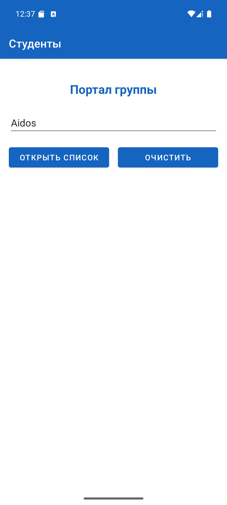
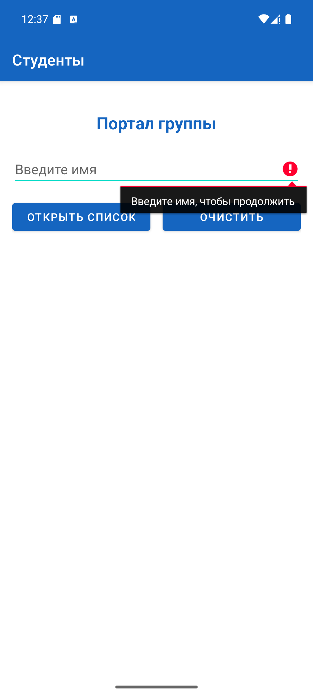
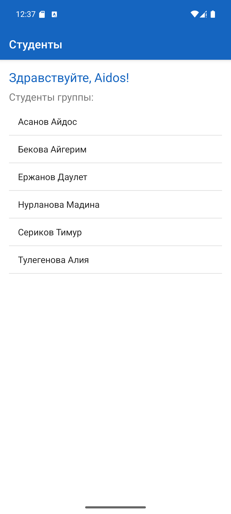
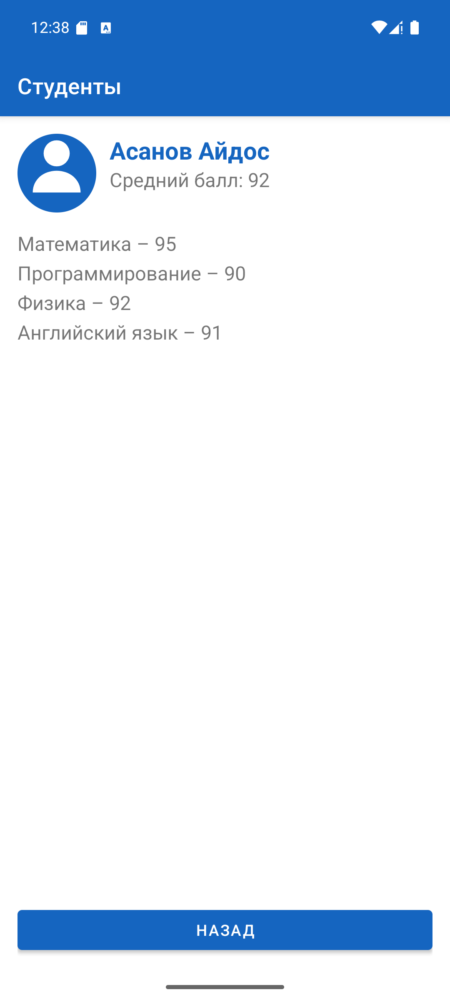

# Портал группы: студенты и оценки

Учебное Android-приложение на Kotlin (XML-разметка, без Jetpack Compose). Практическая работа по дисциплине «Разработка мобильных приложений».

## Что делает приложение

1. **MainActivity** (стартовая, `LinearLayout`) – ввод имени пользователя. Пустое имя не пропускается.
2. **ListActivity** (`LinearLayout` + `ListView`) – приветствие и список студентов группы.
3. **DetailActivity** (`RelativeLayout`) – карточка студента: средний балл и оценки по предметам.

Переходы выполняются явными `Intent` с передачей данных через `putExtra()`:
`MainActivity` → (имя) → `ListActivity` → (студент, средний балл, оценки) → `DetailActivity`.

Строки, цвета и размеры вынесены в `app/src/main/res/values`. Во всех Activity логируются методы жизненного цикла и действия пользователя (`Log.d / i / w`).

## Версии

| Параметр | Значение |
|---|---|
| minSdk | 26 (Android 8.0) |
| targetSdk | 37 (Android 17) |
| compileSdk | 37 (Android 17) |
| Android Gradle Plugin | 9.4.0 |
| Gradle | 9.6.0 |
| Проверено на | эмулятор Pixel 8, Android 15 (API 35) |

## Сборка

Открыть папку проекта в Android Studio и запустить `app`, либо из консоли:

```
gradlew assembleDebug
```

APK: `app/build/outputs/apk/debug/app-debug.apk`.

## Логи

Фильтр в Logcat: `tag:MainActivity | tag:ListActivity | tag:DetailActivity`.
Сохранённый журнал – `logs/logs.txt`.

## Скриншоты

| Главный экран | Пустое имя | Список | Карточка студента |
|---|---|---|---|
|  |  |  |  |
